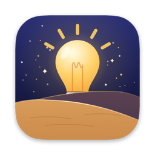
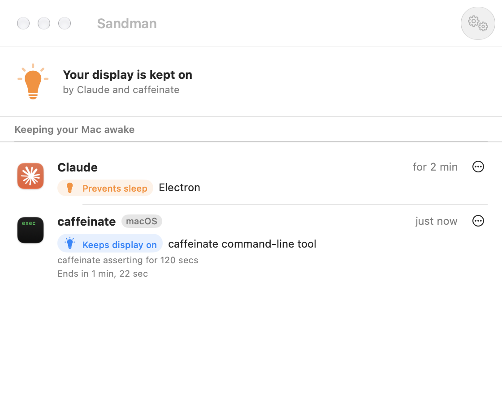

<p align="center">
  
</p>

<h1 align="center">Sandman</h1>

<p align="center">A macOS menu bar app that shows which apps are keeping your Mac awake.</p>

<p align="center">
  
</p>

## Why

Your Mac didn't go to sleep, or the display stayed on all night, and you don't know why. macOS knows: an app has to ask it before blocking sleep. But the only built-in way to see who asked is `pmset -g assertions` in Terminal. Sandman puts the same information in your menu bar.

## Features

- **A bulb in the menu bar** shows the state at a glance:
  - outline bulb: your Mac can sleep
  - filled bulb: something is keeping your Mac awake
  - bulb with rays: something is keeping the display on
- **A dropdown and a window** list each app with its icon, what it blocks, why, for how long, and when it stops if it set a timeout.
- **The real culprit, not the messenger.** Helper processes are grouped under their app (Chrome Helper → Chrome), and blockers that macOS services hold for another app are shown under that app: Spotify, not `coreaudiod`.
- **Readable reasons.** `com.apple.audio.BuiltInSpeakerDevice.context.preventuseridlesleep` becomes "Playing audio on MacBook Pro Speakers".
- **No flicker.** Apps often block sleep for a few seconds while finishing background work. That can't keep your Mac awake, so a blocker only counts once it has lasted 10 seconds. Shorter ones are listed under Background Activity.
- **While you were away.** When you come back after 15 minutes or more, the dropdown shows what happened: how long your Mac was awake and asleep, which apps kept it awake and for how long, and how often macOS woke it in the background (network activity, maintenance, notifications). The window's History tab keeps one entry per absence for 30 days.
- **Quit or force quit** the culprit from the row's ⋯ menu, its context menu, or by swiping left. Sandman only offers this for regular apps and processes you started, never for macOS's own services.

## Requirements

- macOS 27 or later
- Xcode 27 to build it

## Build and install

You don't need an Apple Developer account. Xcode signs the app to run on your own Mac.

Open `Sandman.xcodeproj` in Xcode and press ⌘R, or build a release and copy it to Applications:

```bash
xcodebuild -project Sandman.xcodeproj -scheme Sandman -configuration Release -derivedDataPath build/DerivedData build
```

```bash
ditto build/DerivedData/Build/Products/Release/Sandman.app /Applications/Sandman.app
```

To start Sandman when you log in, turn on **Open at Login** in its menu bar dropdown. It then starts quietly in the menu bar; open Sandman again (from Spotlight or Finder) to show its window.

## How it works

Every 2 seconds Sandman reads powerd's power assertions with `IOPMCopyAssertionsByProcess`, the same data `pmset -g assertions` prints. powerd only sends change notifications to clients registered through private API, so Sandman polls; one read takes about 0.1 ms.

Each assertion is attributed to an app:

- The owning process's executable path is mapped to its outermost `.app` bundle, so helpers fold into their app.
- `AssertionOnBehalfOfPID` is followed when a service such as `coreaudiod` or `runningboardd` holds the assertion for another app.
- powerd's own "Prevent sleep while display is on" assertion only mirrors the display state, so it's listed as background activity.

For history, Sandman watches how long it's been since your last keyboard or mouse input, which needs no permission. Background wake-ups and their causes come from the macOS power log (`pmset -g log`), which keeps about a week. History is stored in `~/Library/Application Support/org.ricar.Sandman/history.json`.

The app isn't sandboxed because it needs to look at other processes.

The app icon is drawn in code; see [`Design/AppIcon.swift`](Design/AppIcon.swift).

## License

MIT. See [LICENSE](LICENSE).
